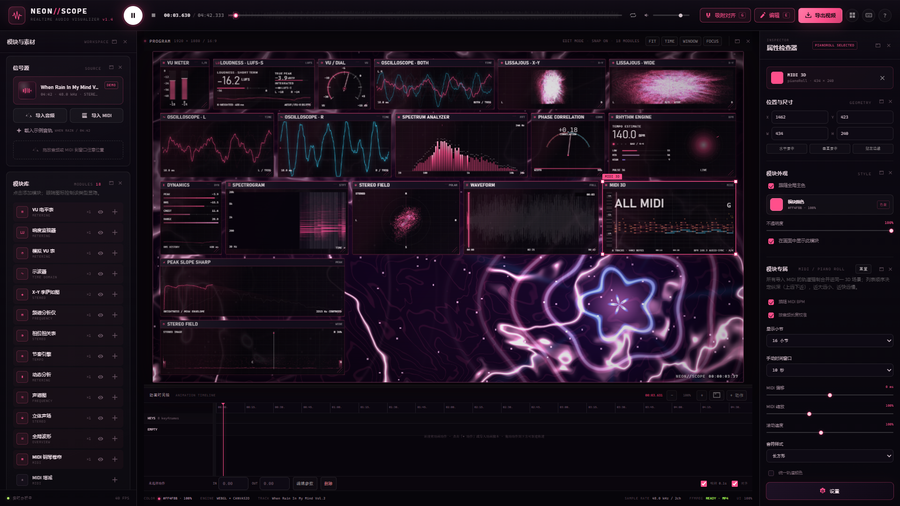

# NEON//SCOPE `CANARY`

**前沿测试频道 · 功能最先落地 · 不保证稳定**

[](https://github.com/Tatsukini/Tatsukini-NEON-SCOPE-Audio-Visualization-Canary/releases/tag/V0.1.4_Alpha_Canary_1114_12)
[](LICENSE)
[](https://github.com/Tatsukini/Tatsukini-NEON-SCOPE-Audio-Visualization)

> [!WARNING]
> **这是 Canary 测试频道，不是稳定版。**
> 本仓库的每个构建都直接对应一轮开发对话的改动，可能包含未完成的功能、行为变更、UI 重排与键位调整；存档与设置结构也可能随构建变化而不再兼容。跨构建恢复失败属于预期内的测试风险。
> 需要稳定出片，请使用 [稳定版频道](https://github.com/Tatsukini/Tatsukini-NEON-SCOPE-Audio-Visualization/releases)。

Canary 与稳定版共享同一套前端资源与桌面外壳，代码同源；差别只在发布节奏与验收强度。本仓库的 Release 说明均由该轮开发对话的实际改动汇总而成，涉及界面的版本会附上对应的测试截图。

---

## 频道对照

| | **Canary（本仓库）** | **Stable** |
| --- | --- | --- |
| 定位 | 前沿功能试验场，供测试与尝鲜 | 面向日常使用与出片 |
| 更新节奏 | 每轮改动单独构建、单独发版 | 功能沉淀并回归后发布 |
| 稳定性 | 可能引入行为变更、UI 重排、键位调整 | 冻结键位与工作流 |
| 存档兼容 | 每个构建都可能调整存档 / 设置结构 | 尽量保持兼容 |
| 问题反馈 | 本仓库 Issues，请注明构建号 | 稳定版仓库 Issues |
| 许可 | **AGPL-3.0-or-later**（比稳定版 GPL 更严格） | GPL-3.0-or-later |

---

## 界面测试图

以下截图全部取自当前构建 `V0.1.4_Alpha_Canary_1114_12`，1920×1080，示例工程 `WHEN RAIN`。

| 工作台 · 编辑与吸附 | 专注预览 · 无侧栏 |
| --- | --- |
|  |  |

| 设置 · 硬件（FFT 与资源配额） | 插件管理器 |
| --- | --- |
|  |  |

| 视频导出 | CATBOT PAPER 主题 |
| --- | --- |
|  |  |

---

## 本构建

| 项目 | 值 |
| --- | --- |
| 构建号 | `V0.1.4_Alpha_Canary_1114_12` |
| 通道 | Canary / Alpha |
| 基于 | `V0.1.4_Alpha_Canary_1114_11` |
| 构建日期 | 2026-11-14 |
| 许可 | AGPL-3.0-or-later（见 [LICENSE](LICENSE)、[NOTICE](NOTICE)） |
| 可执行文件 | `dist\NEON-SCOPE.exe`、`NEON-SCOPE-win64.zip` |

### 本轮改动

- **基础信息模块不随信息编辑刷新**：BASIC INFORMATION 是静态缓存模块，封面图在图层绘制之后才异步解码完成，缓存键不再变化，画面会一直停在「COVER ART」占位状态；清除封面时也可能残留上一张图。现在封面加载完成后主动让该模块缓存失效并重绘，清除封面时同步清空图片；过期加载结果会被丢弃，快速连续换图不会回填错封面。
- 文本字段（歌名 / 艺术家 / 作曲 / 专辑 / 流派 / BPM / 音轨号）本已参与缓存键，本轮一并实测确认暂停状态下也会即时刷新。
- **模块偶发消失已解决**：经 1114_9 的模块渲染隔离与 1114_10 撤回预览缓存链路后不再复现，本版起不再列为已知问题。

### 测试重点

1. **封面刷新**：暂停状态下导入封面，确认 BASIC INFORMATION 模块在一两帧内显示封面；再次更换封面应直接替换；清除封面后恢复「COVER ART」占位框。
2. **文本刷新**：暂停状态下修改歌名 / 艺术家 / 作曲 / 专辑 / 流派 / BPM / 音轨号，确认模块文字立即变化。
3. **长时间播放**：连续播放 10 分钟以上并切换主题、主色、扫描线、窗口尺寸，确认所有模块始终可见。

### 回归清单

- [ ] 首次启动 → 确认 Alpha 提示 → 载入示例工程
- [ ] 暂停时导入 / 更换 / 清除封面，确认基础信息模块同步刷新
- [ ] 暂停时修改基础信息文本字段，确认模块文字立即变化
- [ ] 播放 10 分钟以上，确认舞台保持锐利、所有模块始终可见
- [ ] 修改模块位置 / 尺寸 / 标题 / 颜色，确认预览即时更新
- [ ] 隐藏 / 独显模块后再「显示全部」，确认布局与内容一致
- [ ] 导出 10 秒视频，检查慢模块逐帧变化、水印与片头片尾
- [ ] 以 125% / 150% / 200% 系统缩放打开设置，确认侧边栏始终纵向
- [ ] 设置面板走一遍，重启后核对设置与主色

---

## 快速开始（EXE）

**双击 `dist\NEON-SCOPE.exe`**。无需安装 Node.js 或 .NET 运行时。

- 运行环境：Windows 10 / 11 x64，依赖系统自带的 **Microsoft Edge WebView2 Runtime**。
- 未签名构建，首次运行可能出现 SmartScreen 提示：更多信息 → 仍要运行。
- 数据目录优先 `%LOCALAPPDATA%\NEONScope\`，不可写时回退到 EXE 同目录的 `NEONScopeData\`；日志为其中的 `neon-scope.log`。
- 设置、布局与主色自动保存；工程状态默认不跨启动恢复，可在 设置 → 文件 开启「自动存档恢复」。
- 导出视频默认保存到系统「下载」文件夹。

网页版（开发 / 调试）：

```bash
node server.mjs
```

需要 Node.js 18+；加 `--no-open` 可避免自动拉起浏览器。EXE 与网页版共用同一套 `index.html / styles.css / js` 资源。

---

## 运行环境与硬件下限

| 项目 | 要求 |
| --- | --- |
| 平台 | Windows 10 1809（17763）及以上 / Windows 11，仅 x64；暂无 ARM64 原生构建 |
| 运行时 | Microsoft Edge WebView2 Runtime（大多数 Win10 / 11 已预装；缺失时程序会给出下载地址） |
| 内存 | 8 GB 起；4K 导出建议 16 GB |
| 显卡 | 支持 DirectX 11 的 GPU，并启用硬件加速；无独显时依赖核显 |
| 磁盘 | 程序约 90 MB；默认 24 Mbps 导出约 180 MB/分钟，40 Mbps 约 300 MB/分钟 |
| 显示 | 1366×768 起可编辑；1920×1080 及以上推荐 |
| 音频 | 任意可用的 Windows 输出设备；导出音频直接取自 WebAudio，无需声卡回录或虚拟声卡 |

### 硬件下限

推算依据（当前应用结构）：WebView2 / Chromium 多进程外壳；舞台按 1920×1080 × DPR（上限 1.5）直绘，1080p 窗口实际缓冲约 2880×1620；默认 FFT 8192、双声道分析；示例工程 19 个模块，单帧逐模块绘制并叠加辉光与扫描线；导出为实时录制后由 FFmpeg 转码。

| 平台 | 最低配置 | 推荐配置 |
| --- | --- | --- |
| Intel | 第 8 代 Core i3-8100 / i5-8250U（4 核起）+ HD 530 / UHD 630 核显 + 8 GB 内存 | 第 12 代 Core i5-12400 及以上 + UHD 730 / 770 或 Arc A380 / RTX 3050 + 16 GB 内存 |
| AMD | Ryzen 3 1200 + RX 550，或 Ryzen 3 2200G（Vega 8 核显），4 核起 + 8 GB 内存 | Ryzen 5 5600 及以上 + RX 6600 或更强 + 16 GB 内存 |

- **最低配置**：1080p 预览约 30 FPS，适合 1080p30 导出；模块较多时把 `设置 → 硬件 → FFT` 降到 4096 / 2048，或隐藏部分模块。
- **推荐配置**：1080p60 预览流畅，可进行 4K60 录制。
- **低于下限**（双核酷睿、FX 系列、仅支持 DX10 的显卡）：预览会明显掉帧，导出可能降速，不保证可用。

---

## 快捷键（常用）

按 `F1` 打开可搜索、可重绑定的完整快捷键映射；完整列表见 [稳定版 README](https://github.com/Tatsukini/Tatsukini-NEON-SCOPE-Audio-Visualization#快捷键)。

| 键 | 操作 |
| --- | --- |
| `Space` | 播放 / 暂停 |
| `←` / `→` | 快退 / 快进 1 秒（长按每秒 5 步） |
| `↑` / `↓` · `Shift + ← / →` | 微调所选模块 1 px · 10 px |
| `Delete` | 删除所选动画动作或模块 |
| `E` / `F` | 编辑模式 / 专注预览 |
| `G` / `L` | 吸附对齐 / 循环播放 |
| `Ctrl + S` / `Ctrl + Z` | 保存工程 / 撤销动画编辑 |
| `Ctrl + Shift + E` | 打开视频导出 |

---

## 与稳定版的差异

Canary 具备稳定版的全部工作台能力，并先行接收新功能；完整功能清单、插件规范与架构说明以[稳定版 README](https://github.com/Tatsukini/Tatsukini-NEON-SCOPE-Audio-Visualization)为准。当前基于 `V0.1.4` 线先行落地：

- **预览原生分辨率直绘**：不降分辨率、不由 CSS 放大，预览与导出共用同一套直绘路径。
- **界面音效**：开关、按钮与关键操作使用合成音效，无外部音频文件。
- **退出自动存档握手**：退出前等待存档写完，失败时显示状态覆盖层。
- **方向键 / Delete 语义**：方向键微调模块，Delete 无需先聚焦面板即可删除。
- **设置侧边栏纵向布局**：窄窗口收为图标栏，不再退化成横向按钮条。

---

## 已知限制

- 实时录制导出，不支持后台静默渲染；导出期间保持窗口在前台。
- 4K / 60FPS 对性能要求高；硬件不稳时会自动降速录制，封装阶段依赖 FFmpeg 恢复原速。
- MIDI 仅驱动可视化，不参与音频合成或分析。
- Canary 构建间的存档、设置与键位可能变化；跨构建异常请先清空应用数据目录再复测。
- 未签名构建在签名启用前仍可能触发 SmartScreen 提示。

---

## 许可 / License

**本仓库自 `V0.1.4_Alpha_Canary_1114_7` 起使用 GNU Affero General Public License v3.0 或更高版本（AGPL-3.0-or-later）**，比稳定版仓库的 GPL-3.0-or-later 更严格：

- 分发修改后的程序时，必须按 AGPL 提供完整对应源代码。
- 如果你修改程序并通过网络让其他用户使用，必须向这些用户提供修改版的对应源代码（AGPL 第 13 条）。
- 不得对 Canary 构建附加额外限制条款；如需更宽松的条款，请使用稳定版仓库的 GPL 构建。

`assets/` 下的示例音频、MIDI、字体与图片仍归各自作者所有，不在 AGPL 范围内；详见 [NOTICE](NOTICE)。应用内 设置 → 关于 → 许可与版权声明 同步列出本程序的 AGPL 条目。

---

## 开发者

```powershell
powershell -ExecutionPolicy Bypass -File .\build-native.ps1
```

要求 .NET 8 SDK；脚本在 `dist\` 生成 `NEON-SCOPE.exe` 并打包 `NEON-SCOPE-win64.zip`。

```
index.html / styles.css    工作台界面
js/                        前端模块、音频分析、MIDI、导出、音效
server.mjs                 网页版本地服务
native/                    C# 桌面外壳（WinForms + WebView2 + Kestrel）
build-native.ps1           重建 EXE
dist/                      可分发 EXE
```

GitHub Actions（`.github/workflows/build-windows.yml`）在推送 `V*` 标签或手动触发时构建未签名产物。Windows 构建正在接入 [SignPath Foundation](https://signpath.org/) 可信代码签名。

反馈请使用本仓库 Issues，并注明构建号与复现步骤。
