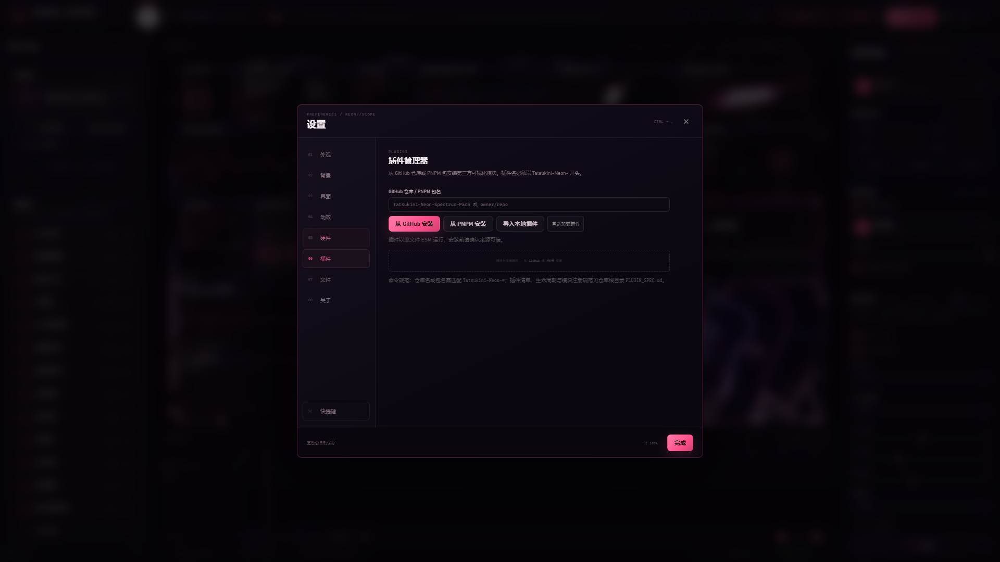
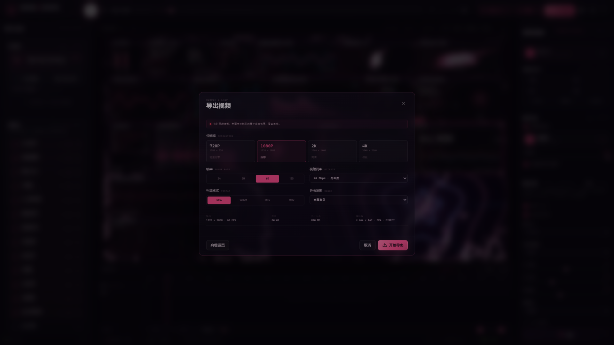
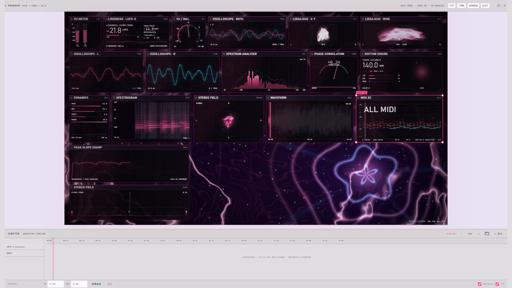

# NEON//SCOPE `CANARY`

**前沿测试频道 · 功能最先落地 · 不保证稳定**

[](https://github.com/Tatsukini/Tatsukini-NEON-SCOPE-Audio-Visualization-Canary/releases/tag/V0.1.4_Alpha_Canary_1114_11)
[](LICENSE)
[](https://github.com/Tatsukini/Tatsukini-NEON-SCOPE-Audio-Visualization)

> [!WARNING]
> **这是 Canary 测试频道，不是稳定版。**
> 本仓库的每个构建都直接对应一轮开发对话的改动，可能包含未完成的功能、行为变更、UI 重排与键位调整；存档与设置结构也可能随构建变化而不再兼容。跨构建恢复失败属于预期内的测试风险。
> 需要稳定出片，请使用 [稳定版频道](https://github.com/Tatsukini/Tatsukini-NEON-SCOPE-Audio-Visualization/releases)。

Canary 与稳定版共享同一套前端资源与桌面外壳，代码同源；差别只在发布节奏与验收强度。本仓库的 Release 说明均由该轮开发对话的实际改动汇总而成，涉及界面的版本会附上对应的测试截图。

---

## 频道对照

| | **Canary（本仓库）** | **Stable** |
| --- | --- | --- |
| 定位 | 前沿功能试验场，供测试与尝鲜 | 面向日常使用与出片 |
| 更新节奏 | 每轮改动单独构建、单独发版 | 功能沉淀并回归后发布 |
| 稳定性 | 可能引入行为变更、UI 重排、键位调整 | 冻结键位与工作流 |
| 存档兼容 | 每个构建都可能调整存档 / 设置结构 | 尽量保持兼容 |
| 问题反馈 | 本仓库 Issues，请注明构建号 | 稳定版仓库 Issues |
| 许可 | **AGPL-3.0-or-later**（比稳定版 GPL 更严格） | GPL-3.0-or-later |

---

## 界面测试图

以下截图全部取自当前构建 `V0.1.4_Alpha_Canary_1114_11`，1920×1080，示例工程 `WHEN RAIN`。

| 工作台 · 编辑与吸附 | 专注预览 · 无侧栏 |
| --- | --- |
|  |  |

| 设置 · 硬件（FFT 与资源配额） | 插件管理器 |
| --- | --- |
|  |  |

| 视频导出 | CATBOT PAPER 主题 |
| --- | --- |
|  |  |

---

## 本构建

| 项目 | 值 |
| --- | --- |
| 构建号 | `V0.1.4_Alpha_Canary_1114_11` |
| 通道 | Canary / Alpha |
| 基于 | `V0.1.4_Alpha_Canary_1114_10` |
| 构建日期 | 2026-11-14 |
| 许可 | AGPL-3.0-or-later（见 [LICENSE](LICENSE)、[NOTICE](NOTICE)） |
| 可执行文件 | `dist\NEON-SCOPE.exe`、`NEON-SCOPE-win64.zip` |

### 本轮改动

- **MIDI O/C 边框遮挡首行**：开启「显示面板边框」时，轨道行改为在 26px 标题栏以下的正文区域内居中排布，行高按正文高度重算；模块总宽高保持不变，未开边框时排布不变。
- **OSCILLOSCOPE 标题跟随声道**：切换「显示声道」为仅左 / 仅右 / 双通道时同步改写标题后缀；绘制标题也按当前选项校正，旧工程中标题与设置不一致的模块同样显示正确。

### 测试重点

1. **MIDI O/C 边框**：开启面板边框，确认第一行完整显示在标题栏下方，最后一行不越过底边；模块尺寸不因开关边框而变化。
2. **声道标题**：把 OSCILLOSCOPE 的显示声道依次切到 L / R / BOTH，确认舞台标题同步变为 `· L` / `· R` / `· BOTH`。
3. **模块消失问题**：播放中切换主题、主色、扫描线、窗口尺寸，确认所有模块每帧都在；控制台不应出现 `Module render failure`。若出现，请记录模块类型与消息。

### 回归清单

- [ ] 首次启动 → 确认 Alpha 提示 → 载入示例工程
- [ ] 播放 30 秒，确认舞台保持锐利、所有模块都在
- [ ] MIDI O/C 开关面板边框，确认首行在标题栏下方、末行不越界
- [ ] OSCILLOSCOPE 切换 L / R / BOTH，确认标题同步
- [ ] 修改模块位置 / 尺寸 / 标题 / 颜色，确认预览即时更新
- [ ] 隐藏 / 独显模块后再「显示全部」，确认布局与内容一致
- [ ] 导出 10 秒视频，检查慢模块逐帧变化、水印与片头片尾
- [ ] 以 125% / 150% / 200% 系统缩放打开设置，确认侧边栏始终纵向
- [ ] 设置面板走一遍，重启后核对设置与主色

---

## 快速开始（EXE）

**双击 `dist\NEON-SCOPE.exe`**。无需安装 Node.js 或 .NET 运行时。

- 运行环境：Windows 10 / 11 x64，依赖系统自带的 **Microsoft Edge WebView2 Runtime**。
- 未签名构建，首次运行可能出现 SmartScreen 提示：更多信息 → 仍要运行。
- 数据目录优先 `%LOCALAPPDATA%\NEONScope\`，不可写时回退到 EXE 同目录的 `NEONScopeData\`；日志为其中的 `neon-scope.log`。
- 设置、布局与主色自动保存；工程状态默认不跨启动恢复，可在 设置 → 文件 开启「自动存档恢复」。
- 导出视频默认保存到系统「下载」文件夹。

网页版（开发 / 调试）：

```bash
node server.mjs
```

需要 Node.js 18+；加 `--no-open` 可避免自动拉起浏览器。EXE 与网页版共用同一套 `index.html / styles.css / js` 资源。

---

## 快捷键（常用）

按 `F1` 打开可搜索、可重绑定的完整快捷键映射；完整列表见 [稳定版 README](https://github.com/Tatsukini/Tatsukini-NEON-SCOPE-Audio-Visualization#快捷键)。

| 键 | 操作 |
| --- | --- |
| `Space` | 播放 / 暂停 |
| `←` / `→` | 快退 / 快进 1 秒（长按每秒 5 步） |
| `↑` / `↓` · `Shift + ← / →` | 微调所选模块 1 px · 10 px |
| `Delete` | 删除所选动画动作或模块 |
| `E` / `F` | 编辑模式 / 专注预览 |
| `G` / `L` | 吸附对齐 / 循环播放 |
| `Ctrl + S` / `Ctrl + Z` | 保存工程 / 撤销动画编辑 |
| `Ctrl + Shift + E` | 打开视频导出 |

---

## 与稳定版的差异

Canary 具备稳定版的全部工作台能力，并先行接收新功能；完整功能清单、插件规范与架构说明以[稳定版 README](https://github.com/Tatsukini/Tatsukini-NEON-SCOPE-Audio-Visualization)为准。当前基于 `V0.1.4` 线先行落地：

- **预览渲染优化**：模块外框与叠加层离屏缓存、慢模块跳帧刷新，导出路径不受影响。
- **界面音效**：开关、按钮与关键操作使用合成音效，无外部音频文件。
- **退出自动存档握手**：退出前等待存档写完，失败时显示状态覆盖层。
- **方向键 / Delete 语义**：方向键微调模块，Delete 无需先聚焦面板即可删除。
- **设置侧边栏纵向布局**：窄窗口收为图标栏，不再退化成横向按钮条。

---

## 已知限制

- 实时录制导出，不支持后台静默渲染；导出期间保持窗口在前台。
- 4K / 60FPS 对性能要求高；硬件不稳时会自动降速录制，封装阶段依赖 FFmpeg 恢复原速。
- MIDI 仅驱动可视化，不参与音频合成或分析。
- Canary 构建间的存档、设置与键位可能变化；跨构建异常请先清空应用数据目录再复测。
- 未签名构建在签名启用前仍可能触发 SmartScreen 提示。

---

## 许可 / License

**本仓库自 `V0.1.4_Alpha_Canary_1114_7` 起使用 GNU Affero General Public License v3.0 或更高版本（AGPL-3.0-or-later）**，比稳定版仓库的 GPL-3.0-or-later 更严格：

- 分发修改后的程序时，必须按 AGPL 提供完整对应源代码。
- 如果你修改程序并通过网络让其他用户使用，必须向这些用户提供修改版的对应源代码（AGPL 第 13 条）。
- 不得对 Canary 构建附加额外限制条款；如需更宽松的条款，请使用稳定版仓库的 GPL 构建。

`assets/` 下的示例音频、MIDI、字体与图片仍归各自作者所有，不在 AGPL 范围内；详见 [NOTICE](NOTICE)。应用内 设置 → 关于 → 许可与版权声明 同步列出本程序的 AGPL 条目。

---

## 开发者

```powershell
powershell -ExecutionPolicy Bypass -File .\build-native.ps1
```

要求 .NET 8 SDK；脚本在 `dist\` 生成 `NEON-SCOPE.exe` 并打包 `NEON-SCOPE-win64.zip`。

```
index.html / styles.css    工作台界面
js/                        前端模块、音频分析、MIDI、导出、音效
server.mjs                 网页版本地服务
native/                    C# 桌面外壳（WinForms + WebView2 + Kestrel）
build-native.ps1           重建 EXE
dist/                      可分发 EXE
```

GitHub Actions（`.github/workflows/build-windows.yml`）在推送 `V*` 标签或手动触发时构建未签名产物。Windows 构建正在接入 [SignPath Foundation](https://signpath.org/) 可信代码签名。

反馈请使用本仓库 Issues，并注明构建号与复现步骤。
