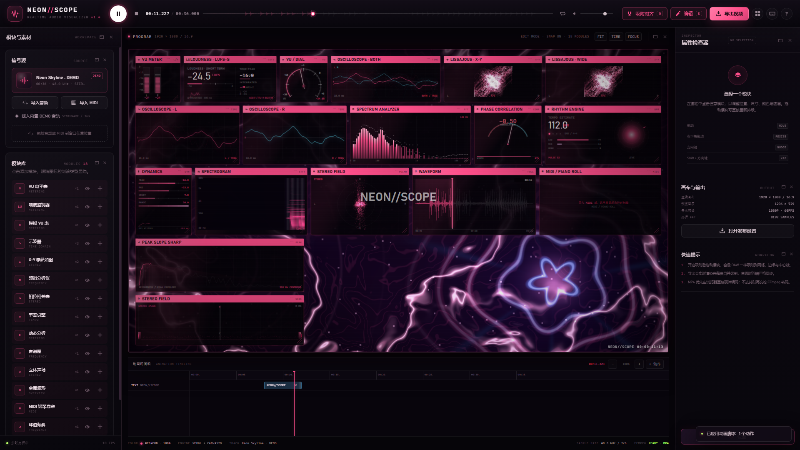

# NEON//SCOPE

[](https://github.com/Tatsukini/Tatsukini-NEON-SCOPE-Audio-Visualization/releases/tag/V0.1.1_1104_alpha_Num.2)

> 当前为 **Alpha 测试版本 V0.1.1_1104_alpha_Num.2**。启动时会显示 Alpha 提示，确认后进入工作台。

实时音频 / MIDI 可视化工作台。导入音频或 MIDI，在仪表盘上自由编排模块，实时渲染并导出带音频的视频。

## V0.1.1_1104_alpha_Num.2 更新摘要

- 动画时间轴：关键帧管理总线、右键菜单、FL 风格关键帧曲线、按属性关键帧与自动插值。
- 新增「基础信息」模块：曲绘、歌曲名、作曲、风格、BPM、曲序、采样率、时长；内部元素随模块缩放。
- Intro 开场卡：中央信息带、带外背景模糊，支持模块专属主/次字体颜色与背景色。
- Intro / text / subtitle / mash 使用绝对坐标；text 支持淡入淡出；subtitle 支持多行、行间距、字号、双轴延展、自动向上堆叠、参数分页和内置确认恢复；mash 支持绝对坐标、双轴延展、参数分页和恢复。
- 设置 → 外观新增四色主题（背景/窗口/字符/图表）与图表跟随颜色；color 动画只影响舞台组件，支持颜色淡入淡出。
- 舞台工具栏新增独立桌面舞台窗口；舞台与时间轴之间支持拖动分隔条。
- 设置 → 外观新增默认字体与恢复默认字体；设置 → 关于新增开发者资料、许可与版权声明、仓库地址。
- 内置确认弹窗：恢复动作参数时不再使用浏览器原生确认框。
- EXE 版本更新至 `1.4.1`。



## 直接运行 EXE（推荐）

**双击 `dist\NEON-SCOPE.exe`** 即可。不需要安装 Node.js，也不需要安装 .NET 运行时。

- 运行环境：Windows 10 / 11 x64。
- 依赖系统自带的 **Microsoft Edge WebView2 Runtime**。如果系统没有，程序会提示下载地址。
- 首次运行可能出现 Windows SmartScreen 提示（程序未签名），选择“更多信息 → 仍要运行”。
- 导出的视频默认保存到 `下载 / Downloads` 文件夹。
- 布局、主色和偏好设置会自动保存，下次启动恢复。

项目根目录下同时提供 `NEON-SCOPE-win64.zip` 作为压缩分发版本（内含 EXE 与使用说明）。

### EXE 的数据位置

优先使用：

```
%LOCALAPPDATA%\NEONScope\
```

如果该位置不可写，会自动回退到 EXE 同目录的 `NEONScopeData\`。日志文件为其中的 `neon-scope.log`。

### MP4 与 FFmpeg

- 在 Windows WebView2 中，MP4 **优先直接录制为 H.264 + AAC**，无需 FFmpeg。
- 如果系统不支持原生 MP4 录制，才会调用 FFmpeg 转码。
- 若需要这条后备路径，请安装 [FFmpeg](https://ffmpeg.org/) 并加入 `PATH`；没有 FFmpeg 也不影响常规 MP4 / WebM 导出。

## 网页版（开发用）

也可以继续用本地 Node 服务运行同一套界面：

**双击 `启动 NEON SCOPE.bat`**，或手动：

```bash
node server.mjs
```

网页版要求 Node.js 18+，MP4 后备转码同样可选依赖 FFmpeg。EXE 和网页版共用同一套 `index.html / styles.css / js` 资源。

## 功能

- **导入音频**：WAV / MP3 / FLAC / OGG / M4A / AAC。
- **导入 MIDI**：内置 Standard MIDI File（Format 0/1）解析器；支持一次选择多个 MIDI，所有文件、所有轨道强制合并进同一个 3D 钢琴卷帘模块。MIDI 只驱动可视化，不合成音频、不替换当前音轨，播放时间轴仍来自当前音频或 DEMO。
- **MIDI 模块总线**：统一管理合并后的全部 MIDI 轨道，可调整 MIDI 偏移（10ms 步进）、音符样式、滚动速度、时间窗口、默认深度、音符厚度、垂直中心、Vibrato、标题 / 和弦叠加，并逐轨设置 M/S、颜色与视觉深度。默认读取 MIDI 的 BPM / 拍号，并结合当前音频长度校准速度，以「显示小节数」自动计算滚动窗口；轨道列表顺序决定 3D 纵深，上远下近，音符近大远小、近快远慢；轨道行尾 × 或 Ctrl+Shift+左键可删除轨道。
- **预览性能**：设置 →「动效」提供 10 FPS 到无限制的预览帧率，以及 VSync 开关；关闭 VSync 后按目标帧率定时渲染，适合测试高刷新显示或限制功耗。
- **MIDI 钢琴卷帘**：所有导入 MIDI 强制合并进同一个 3D 模块；模块专属设置包含每轨 M/S、轨道颜色、单轨视觉深度、音符样式（长方形 / 圆角）、滚动速度，以及标题 / 和弦叠加的文字、位置、颜色、字号、字体和滑入 / 淡入动画。
- **示例工程**：首次打开自动载入 `When Rain In My Mind Vol.2.mp3` 与 6 个配套 MIDI 文件，并强制合并成一个 3D 钢琴卷帘。
- **16 个可视化模块**：VU 电平、响度、模拟 VU 表、示波器、X-Y 李萨如、频谱、相位相关、节奏、动态、声谱图、立体声场、全局波形、MIDI 钢琴卷帘、峰值倾斜、声场分布、基础信息。
- **自由布局**：拖动移动、四角缩放、属性面板精确输入、图层顺序、复制/删除。
- **窗口化工作区**：左侧「模块与素材」、中央舞台、右侧「属性检查器」都有窗口化 / 关闭按钮；每张内部卡片（信号源、模块库、位置尺寸、模块外观、专属参数、图层、画布输出、快速提示）也都可以独立浮动、关闭、拖动和缩放，像 OBS 面板一样排列。顶部九宫格按钮可恢复。
- **DAW 式吸附对齐**：顶部磁铁开关或 `G`。吸附画布边缘、中心线、其他模块边缘/中心线，并显示参考线。
- **模块专属参数**：每个可视化模块不再是同一套模板。VU 表有 LED 段数和峰值保持，示波器有轨迹线宽、余晖和网格，频谱有频段数量，声谱图有色图/增益，波形有 BAR/LINE/FILL 样式，钢琴卷帘有时间窗口等。
- **模块右键菜单**：右键任意模块，可快速复制、隐藏、独显、居中、重置尺寸、调整图层或删除。
- **模块显隐**：模块库中点击眼睛图标切换同类模块；也可单个隐藏。
- **RGBA 色盘 + 主题预设**：使用色相/明度/饱和度面板 + RGB/A 数值选择主题色、模块色或纯色背景；支持透明度，并提供 MAGENTA / CYAN / AMBER / VIOLET 快捷预设。
- **桌面设置窗口**：EXE 中点击右侧栏底部「设置」会打开独立的原生桌面窗口（不是软件内弹层）；网页版回退为同功能设置弹层。设置修改会实时同步回主窗口。
- **界面缩放**：70%–150% 全局 UI 缩放，**设置窗口自身也会同步缩放**；达到较大缩放时会自动切换紧凑布局，避免顶栏、侧栏和按钮重叠。
- **三种界面风格**：NEON GRID（当前霓虹仪表盘）、VIDI STUDIO（深色青色霓虹剪辑台）、CATBOT PAPER（浅色直角几何编辑界面），在设置 →「界面」切换。
- **明暗模式**：设置 →「界面」提供跟随主题 / 深色 / 浅色三个选项；浅色模式适用于全部主题，深色模式也让 CATBOT PAPER 拥有深色版本。
- **主题色 / 背景色联动**：CATBOT PAPER 的纸张底色由背景色自动调和，强调色、选中态、品牌标记和设置按钮跟随主题色；浅色模式的纸张底色同样会随背景色变化。
- **信息编辑面板**：初始隐藏，可从顶部九宫格面板菜单启用；编辑歌曲名、艺术家、专辑、流派、BPM、封面，并可把信息卡叠加进预览和导出。
- **动画设计面板**：初始隐藏；可按时间码添加闪白、文字、字幕、颜色染色、淡出动作，支持删除/清空，动作会直接进入导出视频。
- **工程存档**：保存为单个 `.NEON`（ZIP 工程包），可导出/导入；包含 `project.json`、动画、音频源文件、MIDI 源文件、背景和封面。`Ctrl+S` 快速保存。
- **动画脚本**：支持 `00:00.000 text ...`、`mash`、`color`、`effect blur`、`bpm` 等时间码脚本的导入/导出。
- **动画时间轴**：Blender 风格底部时间轴，显示轨道、动作条、播放头；可拖动移动、拉伸时长、删除，并支持缩放/吸附。
- **文件路径**：设置 →「文件」可指定默认存档路径与视频导出路径；EXE 中使用原生文件夹选择器。存档默认保存到本机应用数据目录下的 `Saves`，导出留空时使用系统 Downloads。
- **背景图片**：上传后实时显示图片预览并持久化；支持暗化、模糊、完整显示、Ken Burns 缓慢推拉、漂移、呼吸、轻摇和强节拍动效。
- **动效 / 导出效果**：设置 →「动效」可调节背景图片动效、片头渐入、片尾渐出和节拍闪光，效果直接绘制进导出视频。
- **快捷键映射**：快捷键映射窗口，支持搜索、重绑定、恢复默认；`Tab`、`Esc` 和鼠标按键不可绑定。默认键位为 FL Studio 风格的工作流。
- **视频导出**：720P / 1080P / 2K / 4K，30/60 FPS，8–40 Mbps，MP4 或 WebM；可选完整曲目 / 前 30 秒 / 前 10 秒。
- **实时分析**：8192 sample FFT，双通道波形、峰值保持、短时/综合响度近似、节拍脉冲和 BPM。
- **完全本地处理**：媒体文件不会上传到网络。

## 快捷键

按 `F1` 或点击顶部键盘图标打开**快捷键映射**窗口，可按功能搜索、点击右侧键位重新绑定，也可一键恢复默认。`Tab`、`Esc` 和鼠标按键被禁止绑定。

默认键位：

| 键 | 操作 |
|---|---|
| `Space` | 播放 / 暂停 |
| `Home` | 停止并回到开头 |
| `G` | 吸附对齐开关 |
| `E` | 编辑 / 预览模式 |
| `F` | 专注预览（再按退出） |
| `L` | 循环播放 |
| `Ctrl + Shift + E` | 打开视频导出 |
| `Ctrl + ,` | 打开设置 |
| `F1` | 快捷键映射 |
| `F2` | 工作台指南 |
| `F3` | 打开独立舞台窗口 |
| `T` | 显示 / 收起动画时间轴 |
| `K` | 显示关键帧管理总线 |
| `A` | 添加动画动作 |
| `Ctrl + Shift + R` | 恢复默认面板布局 |
| `Ctrl + D` | 复制所选模块 |
| `Shift + H` / `Shift + V` | 模块水平 / 垂直居中 |
| `← ↑ ↓ →` | 微调所选模块 |
| `Shift + 方向键` | 微调 10 px |
| `Delete` | 删除所选模块 |
| `Esc` | 关闭窗口 / 取消选择 / 退出专注（不可重绑定） |

## 使用建议

1. 打开后点击画面中央播放键，先用示例音频与 MIDI 调整视觉；也可以导入自己的音频 / MIDI。
2. 在左侧「模块与素材」中增减模块；在画布中点击模块后，于右侧「属性检查器」精确调整位置、尺寸、颜色、透明度和**该模块专属参数**。右键模块可打开快捷操作菜单。
3. 编辑时保持「吸附对齐」开启，拖动模块会吸附到网格、画布边缘/中线与其他模块边缘；参考线是青色。
4. 点击右侧栏底部「设置」，可以调整四色主题、纯色/图片背景、界面风格、界面缩放、默认字体、动效、GPU/CPU 模式、灵敏度和快捷键。EXE 中这是独立桌面窗口。
5. 左侧、舞台、右侧面板以及内部每张小卡片右上角的窗口 / 关闭按钮可以独立浮动、隐藏或停靠；顶部九宫格按钮可恢复。信息编辑、动画设计默认隐藏，在面板菜单中启用。
6. 导出从曲目开头开始实时录制，耗时约等于曲目长度。导出期间请保持窗口在前台。

## 技术实现

```
音频文件 / MIDI
      │
      ▼
Web Audio AudioBuffer ──► ChannelSplitter ──► AnalyserNode L/R
      │                                            │
      └────────► destination / MediaStreamDestination
                                                   │
                                            实时分析数据
                                                   │
                        WebGL 背景着色器 + Canvas2D 模块合成
                                                   │
                                      Canvas.captureStream + 音轨
                                                   │
                             MediaRecorder (MP4/H.264 或 WebM/VP9)
                                                   │
                             可选：本机 FFmpeg → MP4/H.264 + AAC
```

- **桌面外壳**：C# WinForms + WebView2，内嵌 ASP.NET Core Kestrel 本地服务（仅监听 `127.0.0.1`），使用固定端口段保证 localStorage 持久化。Web 前端嵌入 EXE。
- **分析**：Web Audio `AnalyserNode`（8192 point FFT）获取时域与频域数据，并计算 RMS、峰值、相关度、低/中/高频能量、节拍包络和 BPM。响度显示为近似 K-weighted 值，非母带级认证仪表。
- **MIDI**：自写 SMF 解析器处理 tempo map、velocity、program、CC10 pan、CC7 volume 与鼓通道；解析结果只供钢琴卷帘模块滚动显示，不进入音频合成或分析链路。
- **渲染**：默认 GPU 模式使用 WebGL fragment shader 渲染等离子 / 电弧 / 霓虹环背景；CPU 模式提供 Canvas2D 回退。示波器、频谱、声谱图、声场等模块由高分辨率 Canvas2D 合成。
- **导出**：`CaptureStream` 录制画布，同时混合 Web Audio 音轨。Windows WebView2 支持直接 MP4/H.264 硬件录制；不支持时由本地 FFmpeg 转码。下载由 WebView2 原生下载管理器保存到“下载”文件夹。

### 工程结构

```
index.html / styles.css          工作台界面
js/                              前端模块、音频分析、MIDI、导出
server.mjs                       网页版本地服务
native/                          C# 桌面外壳源码
  Program.cs / MainForm.cs       WinForms + WebView2 窗口
  ServerHost.cs                  内嵌 Kestrel + FFmpeg 转换 API
  AppPaths.cs                    可写数据目录与日志
  app.ico                        应用图标
build-native.ps1                 重建 EXE
dist/NEON-SCOPE.exe              可分发 EXE
```

## 重新构建 EXE

要求：.NET 8 SDK。

在项目目录运行：

```powershell
powershell -ExecutionPolicy Bypass -File .\build-native.ps1
```

脚本会在 `dist\` 生成新的 `NEON-SCOPE.exe` 并打包 `NEON-SCOPE-win64.zip`。

## 已知限制

- 画布固定 16:9（逻辑分辨率 1920×1080），所有导出分辨率均为 16:9。
- 视频导出为实时录制，不支持后台静默渲染；4K/60FPS 对性能要求较高，建议先用 1080P。
- MIDI 只作为钢琴卷帘可视化数据，不参与音频分析或合成；请使用导入音频或 DEMO 作为播放时间轴。
- EXE 未做代码签名，SmartScreen 可能提示；这不影响功能。
- 如果系统没有 WebView2 Runtime，需要先安装（Windows 10/11 通常已经自带）。
