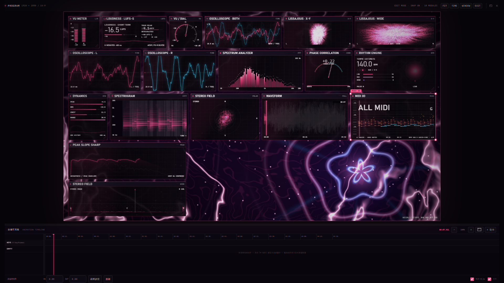

# NEON//SCOPE `CANARY`

**前沿测试频道 · 功能最先落地 · 不保证稳定**

[](https://github.com/Tatsukini/Tatsukini-NEON-SCOPE-Audio-Visualization-Canary/releases/tag/V0.1.4_Alpha_Canary_1117_3)
[](LICENSE)
[](https://github.com/Tatsukini/Tatsukini-NEON-SCOPE-Audio-Visualization)

> [!WARNING]
> **这是 Canary 测试频道，不是稳定版。**
> 本仓库的每个构建都直接对应一轮开发对话的改动，可能包含未完成的功能、行为变更、UI 重排与键位调整；存档与设置结构也可能随构建变化而不再兼容。跨构建恢复失败属于预期内的测试风险。
> 需要稳定出片，请使用 [稳定版频道](https://github.com/Tatsukini/Tatsukini-NEON-SCOPE-Audio-Visualization/releases)。

Canary 与稳定版共享同一套前端资源与桌面外壳，代码同源；差别只在发布节奏与验收强度。本仓库的 Release 说明均由该轮开发对话的实际改动汇总而成，涉及界面的版本会附上对应的测试截图。

---

## 频道对照

| | **Canary（本仓库）** | **Stable** |
| --- | --- | --- |
| 定位 | 前沿功能试验场，供测试与尝鲜 | 面向日常使用与出片 |
| 更新节奏 | 每轮改动单独构建、单独发版 | 功能沉淀并回归后发布 |
| 稳定性 | 可能引入行为变更、UI 重排、键位调整 | 冻结键位与工作流 |
| 存档兼容 | 每个构建都可能调整存档 / 设置结构 | 尽量保持兼容 |
| 问题反馈 | 本仓库 Issues，请注明构建号 | 稳定版仓库 Issues |
| 许可 | **AGPL-3.0-or-later**（比稳定版 GPL 更严格） | GPL-3.0-or-later |

---

## 界面测试图

以下截图全部取自当前构建 `V0.1.4_Alpha_Canary_1117_3`，1920×1080，示例工程 `WHEN RAIN`。

| 工作台 · 编辑与吸附 | 专注预览 · 无侧栏 |
| --- | --- |
|  |  |

| 设置 · 硬件（FFT 与资源配额） | 插件管理器 |
| --- | --- |
|  |  |

| 视频导出 | CATBOT PAPER 主题 |
| --- | --- |
|  |  |

---

## 本构建

| 项目 | 值 |
| --- | --- |
| 构建号 | `V0.1.4_Alpha_Canary_1117_3` |
| 通道 | Canary / Alpha |
| 基于 | `V0.1.4_Alpha_Canary_1117_1` |
| 构建日期 | 2026-11-16 |
| 许可 | AGPL-3.0-or-later（见 [LICENSE](LICENSE)、[NOTICE](NOTICE)） |
| 可执行文件 | `dist\NEON-SCOPE.exe`、`NEON-SCOPE-win64.zip` |

### 本轮改动

- **属性检查器头部溢出修复**：150% 缩放 / 全屏下选中徽标不再显示超长的完整模块类型，改为模块短名 + 省略号（悬停可看完整类型）；标题保持单行，不再与浮动/关闭按钮重叠。
- **插件能力扩展**：插件可声明自己的设置面板（文本 / 密码 / 多行文本 / 开关 / 下拉 / 颜色 / 数值 / 图片），设置只存本机、不写入 `.NEON`，卸载时清除；新增 `context.storage`、`context.assets`、`context.net.fetch`（CORS 失败时走本机代理）、`context.loadImage` 与 `context.on(...)` 事件。
- **插件模块与选项增强**：支持默认隐藏、尺寸边界、模块库图标与鼠标回调；选项新增 `password`、`textarea`、`image`、`button`，`select` 可动态生成，`text` 长度可配置。
- **插件权限声明**：`permissions` 在安装时确认，`network` / `storage` / `assets` / `clipboard` / `openExternal` 未声明即拒绝。
- **插件文字颜色不再被主题覆盖**：此前渲染层会把插件模块的 `fillText` 强制改成主题文字色，插件自定的灰/蓝等颜色失效（表现为「插件更新了但看起来仍是旧版」）。现在插件 `draw` 自行控制文字颜色，内置模块不变。
- **GitHub 插件按提交拉取**：`raw.githubusercontent.com` 会忽略查询参数缓存旧文件，现改为先取分支最新 commit SHA，再按 SHA 读取 `plugin.json` 与入口（提交不可变、也不占 Contents API 额度），避免“检查不到更新/版本与代码不一致”；GitHub API 限流（60 次/小时）时自动回退 CDN 并在状态栏标注。
- **插件代码哈希与强制重同步**：激活后记录入口代码 SHA-256；「检查更新」同时比较版本号与哈希，版本相同但代码不同也提示「代码已变化」；「重载」对远程插件重新下载后再激活；插件卡片显示 `CODE xxxxxxxx` 便于核对。
- **插件更新检查**：插件管理器新增「检查更新」，逐个检查 GitHub / PNPM 插件的最新版本；有更新时弹出原生 Windows 对话框，「当前版本 → 最新版本」可勾选（全选 / 全不选），确认后逐个下载并热加载。设置窗口中检查时同样由主窗口弹出；更新完成后设置窗口的插件列表会立即刷出新版本。
- **卸载无残留**：卸载插件时同步清理模块注册、绘制器、舞台实例、选中状态、工程存档与排版槽位中的引用。
- **插件热加载**：安装、更新或重载插件后立即生效，无需重启应用。更新时先调用旧实例的 `deactivate()`，再整体替换模块定义、选项与 `draw`，舞台上已有模块直接使用新版绘制；失败更新会保留上一个可用版本。原生设置窗口中的插件操作会通知主窗口立即同步并保持启用。
- **原生窗口菜单栏「文件」**：使用 Windows 系统标题栏与原生菜单栏（位于标题栏正下方），包含「设置…」（直达设置 → 文件）与「新建存档…」（确认后把当前工程保存为 `[基础信息名称]-MMDD-Num`.NEON，再清空舞台并开始新工程；同日编号自动递增）。菜单栏与下拉菜单为深色配色，支持 Alt 键访问；页面内容始终完整显示在菜单栏下方。
- **无改动直接退出**：启动到关闭期间工程没有任何改动时，跳过关闭确认与自动存档遮罩直接退出；有改动时保持原有保存 / 托盘流程。
- **关于界面新增打赏通道**：设置 → 关于新增「支持项目开发」区块，提供爱发电（https://afdian.com/a/tatsukini2333）与 Unifans（https://app.unifans.io/c/tatsukini2333）两个入口；文案为「支持项目开发，并且 Buy Me a Coffee！选择其中一个通道即可」，点击任一按钮在系统浏览器打开对应页面。
- **修复「导入的 MIDI / 轨道列表 / 总线」三者对不上**：导入此前只做追加，旧工程（120 BPM）与本次分轨（170 BPM）静默混排；逐轨删除留下的空层仍写进存档；和弦模块用位置下标记录轨道，锁定到旧曲目的 Vox 轨，0:44 恰好落在空档，显示 N.C.。
  - 导入与现有 MIDI 的 BPM 不一致时弹出选择：「替换现有 MIDI」只保留本次导入，「追加导入」合并两批轨道；内置 DEMO MIDI 在导入真实 MIDI 时自动替换。
  - 解析、合并、读取存档三处剔除 0 音符的空层，删轨残留不再累积。
  - 和弦轨道改存稳定的 `层ID:层内轨道号`，旧数字存档首次打开自动迁移，目标不存在时回落到自动。
  - 和弦「自动」改为合并全部轨道（排除通道 9）推算，分轨工程也能得到完整和弦。
- **总线不再依赖 MIDI 3D 模块**：缺少模块时以只读列表展示实际载入的文件、轨道名、音符数与 BPM，并提供「创建 MIDI 3D 模块」「清空全部 MIDI」；有模块时摘要行也提供「清空」，方便重置混入的旧工程。
- **按文件移除 MIDI**：无 MIDI 3D 时文件清单每行右侧新增 ×，可单独移除某个文件（只影响工程，不删除磁盘文件）；移除后其轨道、颜色 / 深度 / M / S 与层专属钢琴卷帘一并清理，其余轨道号自动前移。

### 测试重点

1. **文件菜单**：窗口菜单栏「文件」→「设置…」应打开设置的文件页；「新建存档…」取消不应产生文件，确认后当前工程保存为 `名称-MMDD-N.NEON` 并清空舞台，同日再次新建编号递增。页面内容不应被菜单栏遮挡，标题栏为系统原生样式。
2. **无改动退出**：打开应用后不做任何操作直接关闭，应跳过关闭确认与存档动画；改动模块位置 / 信息 / MIDI 后再关闭，应恢复原有确认与自动存档流程。
3. **关于界面**：设置 → 关于，确认「支持项目开发」区块显示两个通道，点击爱发电 / Unifans 在浏览器打开对应页面。
2. **MIDI 导入**：先导入一批 120 BPM 的 MIDI，再导入 170 BPM 的另一批，确认弹出「替换 / 追加」选择；选替换后总线与模块库只剩新文件，选追加后两批轨道都在。导入真实 MIDI 时内置 DEMO MIDI 自动让位。
2. **和弦显示**：默认「自动」应基于全部轨道给出和弦；切换到某条单轨后显示该轨自身和弦；删除该轨后自动回落，不显示其它轨道的和弦。
3. **MIDI 总线**：删除 MIDI 3D 模块后，总线仍列出全部文件与轨道，每行 × 可移除单个文件；「清空全部 MIDI」会同时清空 FL 播放流、和弦与鼓组步进的数据。
4. **既有模块**：FL 播放流、鼓组步进与拍号在导入 / 清空 / 重新导入后仍同步，无控制台报错。

### 回归清单

- [ ] 首次启动 → 确认 Alpha 提示 → 载入示例工程
- [ ] 导入多批 MIDI，确认速度冲突时询问替换 / 追加，空层不再出现在总线
- [ ] 和弦模块「自动」与指定轨道都能显示和弦，轨道丢失后自动回落
- [ ] 删除 MIDI 3D 模块后总线仍可查看文件清单，重建 / 清空按钮可用
- [ ] 导入 MIDI 后三个新模块都能正确渲染，MIDI 总线改颜色 / M / S 后 FL 播放流即时跟随
- [ ] 鼓组步进板块默认隐藏，添加模块后自动出现并填充当前小节，鼓点在模块中同步，上限 7 条
- [ ] 基础信息拍号 / 调性输入即时生效，非法拍号标红
- [ ] 切换拍号后 BPM 模块、钢琴卷帘、FL 播放流、鼓组步进的小节一致
- [ ] 保存工程并重启，确认鼓组步进轨道、拍号、调性与和弦轨道选择被保留
- [ ] 暂停时修改基础信息文本字段，确认模块文字立即变化
- [ ] 播放 10 分钟以上，确认舞台保持锐利、所有模块始终可见
- [ ] 修改模块位置 / 尺寸 / 标题 / 颜色，确认预览即时更新
- [ ] 隐藏 / 独显模块后再「显示全部」，确认布局与内容一致
- [ ] 导出 10 秒视频，检查慢模块逐帧变化、水印与片头片尾
- [ ] 以 125% / 150% / 200% 系统缩放打开设置，确认侧边栏始终纵向
- [ ] 设置面板走一遍，重启后核对设置与主色

---

## 快速开始（EXE）

**双击 `dist\NEON-SCOPE.exe`**。无需安装 Node.js 或 .NET 运行时。

- 运行环境：Windows 10 / 11 x64 + **Microsoft Edge WebView2 Runtime**；视频导出可选安装 **FFmpeg**（硬件编码、手动码率 / CRF 等进阶选项需要，详见下方「运行环境与硬件下限」）。
- 未签名构建，首次运行可能出现 SmartScreen 提示：更多信息 → 仍要运行。
- 数据目录优先 `%LOCALAPPDATA%\NEONScope\`，不可写时回退到 EXE 同目录的 `NEONScopeData\`；日志为其中的 `neon-scope.log`。
- 设置、布局与主色自动保存；工程状态默认不跨启动恢复，可在 设置 → 文件 开启「自动存档恢复」。
- 导出视频默认保存到系统「下载」文件夹。

网页版（开发 / 调试）：

```bash
node server.mjs
```

需要 Node.js 18+；加 `--no-open` 可避免自动拉起浏览器。EXE 与网页版共用同一套 `index.html / styles.css / js` 资源。

---

## 运行环境与硬件下限

当前构建仍是 **WinForms 外壳 + WebView2（Chromium）**：界面、音频分析与 Canvas 2D 渲染全部运行在 WebView2 内，EXE 已自带 .NET 运行时，不需要额外安装 Node.js 或 .NET。

| 项目 | 要求 |
| --- | --- |
| 平台 | Windows 10 1803（17134）及以上 / Windows 11，仅 x64；深色标题栏在 1809 及以上生效；暂无 ARM64 原生构建 |
| 运行时 | Microsoft Edge WebView2 Runtime（Windows 11 通常预装；Windows 10 随 Edge 更新安装，缺失时程序会给出下载地址） |
| 视频导出 | 可选。建议安装 FFmpeg 并加入 PATH，或把 `ffmpeg.exe` 放在 EXE 同目录 / `resources\` 下；硬件编码、手动码率 / CRF / 预设、降速录制恢复原速与 MKV / MOV 封装都需要它。未安装时，默认设置下使用 WebView2 原生直录（运行时支持 MP4/H.264 时输出 MP4，否则回退 WebM）；选择上述进阶选项时会回退到 WebM 直录 |
| 内存 | 8 GB 起；4K 导出建议 16 GB |
| 显卡 | 支持 DirectX 11 的 GPU，并启用硬件加速；无独显时依赖核显 |
| 磁盘 | 程序与示例资源约 100 MB；默认 24 Mbps 导出约 180 MB/分钟，40 Mbps 约 300 MB/分钟 |
| 显示 | 1366×768 起可编辑；1920×1080 及以上推荐 |
| 音频 | 任意可用的 Windows 输出设备；导出音频直接取自 WebAudio，无需声卡回录或虚拟声卡 |

### 硬件下限

推算依据（当前应用结构）：WebView2 / Chromium 多进程 + Canvas 2D 直绘；预览画布按 CSS 宽度 × DPR（上限 1.5）计算后截断到最大 1920×1080，导出可到 3840×2160；默认 FFT 8192、双声道分析；示例工程 19 个模块，单帧逐模块绘制并叠加辉光与扫描线；导出为实时录制，安装 FFmpeg 时再转码 / 封装。

| 平台 | 最低配置 | 推荐配置 |
| --- | --- | --- |
| Intel | 第 8 代 Core i3-8100 / i5-8250U（4 核起）+ UHD 620 / 630 核显 + 8 GB 内存 | 第 12 代 Core i5-12400 及以上 + UHD 730 / 770 或 Arc A380 / RTX 3050 + 16 GB 内存 |
| AMD | Ryzen 3 1200 + RX 550，或 Ryzen 3 2200G（Vega 8 核显），4 核起 + 8 GB 内存 | Ryzen 5 5600 及以上 + RX 6600 或更强 + 16 GB 内存 |

- **最低配置**：1080p 预览约 30 FPS，适合 1080p30 导出；模块较多时把 `设置 → 硬件 → FFT` 降到 4096 / 2048，或隐藏部分模块。
- **推荐配置**：1080p60 预览流畅，可进行 4K60 录制。
- **低于下限**（双核酷睿、FX 系列、仅支持 DX10 的显卡）：预览会明显掉帧，导出可能降速，不保证可用。

---

## 快捷键（常用）

按 `F1` 打开可搜索、可重绑定的完整快捷键映射；完整列表见 [稳定版 README](https://github.com/Tatsukini/Tatsukini-NEON-SCOPE-Audio-Visualization#快捷键)。

| 键 | 操作 |
| --- | --- |
| `Space` | 播放 / 暂停 |
| `←` / `→` | 快退 / 快进 1 秒（长按每秒 5 步） |
| `↑` / `↓` · `Shift + ← / →` | 微调所选模块 1 px · 10 px |
| `Delete` | 删除所选动画动作或模块 |
| `E` / `F` | 编辑模式 / 专注预览 |
| `G` / `L` | 吸附对齐 / 循环播放 |
| `Ctrl + S` / `Ctrl + Z` | 保存工程 / 撤销动画编辑 |
| `Ctrl + Shift + E` | 打开视频导出 |

---

## 与稳定版的差异

Canary 具备稳定版的全部工作台能力，并先行接收新功能；完整功能清单、插件规范与架构说明以[稳定版 README](https://github.com/Tatsukini/Tatsukini-NEON-SCOPE-Audio-Visualization)为准。当前基于 `V0.1.4` 线先行落地：

- **预览原生分辨率直绘**：按画布原生分辨率直接绘制（最大 1920×1080），不由 CSS 放大；预览与导出共用同一套绘制路径。
- **界面音效**：开关、按钮与关键操作使用合成音效，无外部音频文件。
- **退出自动存档握手**：退出前等待存档写完，失败时显示状态覆盖层。
- **方向键 / Delete 语义**：方向键微调模块，Delete 无需先聚焦面板即可删除。
- **设置侧边栏纵向布局**：窄窗口收为图标栏，不再退化成横向按钮条。

---

## 已知限制

- 实时录制导出，不支持后台静默渲染；导出期间保持窗口在前台。
- 4K / 60FPS 对性能要求高；硬件不稳时会自动降速录制。安装 FFmpeg 时由其恢复原速并封装；未安装时只能按原速直录，帧率不足会出现掉帧。
- MIDI 仅驱动可视化，不参与音频合成或分析。
- Canary 构建间的存档、设置与键位可能变化；跨构建异常请先清空应用数据目录再复测。
- 未签名构建在签名启用前仍可能触发 SmartScreen 提示。

---

## 许可 / License

**本仓库自 `V0.1.4_Alpha_Canary_1114_7` 起使用 GNU Affero General Public License v3.0 或更高版本（AGPL-3.0-or-later）**，比稳定版仓库的 GPL-3.0-or-later 更严格：

- 分发修改后的程序时，必须按 AGPL 提供完整对应源代码。
- 如果你修改程序并通过网络让其他用户使用，必须向这些用户提供修改版的对应源代码（AGPL 第 13 条）。
- 不得对 Canary 构建附加额外限制条款；如需更宽松的条款，请使用稳定版仓库的 GPL 构建。

`assets/` 下的示例音频、MIDI、字体与图片仍归各自作者所有，不在 AGPL 范围内；详见 [NOTICE](NOTICE)。应用内 设置 → 关于 → 许可与版权声明 同步列出本程序的 AGPL 条目。

---

## 开发者

```powershell
powershell -ExecutionPolicy Bypass -File .\build-native.ps1
```

要求 .NET 8 SDK；脚本在 `dist\` 生成 `NEON-SCOPE.exe` 并打包 `NEON-SCOPE-win64.zip`。

```
index.html / styles.css    工作台界面
js/                        前端模块、音频分析、MIDI、导出、音效
server.mjs                 网页版本地服务
native/                    C# 桌面外壳（WinForms + WebView2 + Kestrel）
build-native.ps1           重建 EXE
dist/                      可分发 EXE
```

GitHub Actions（`.github/workflows/build-windows.yml`）在推送 `V*` 标签或手动触发时构建未签名产物；当前仍未启用代码签名，EXE 首次运行可能触发 SmartScreen。

反馈请使用本仓库 Issues，并注明构建号与复现步骤。

