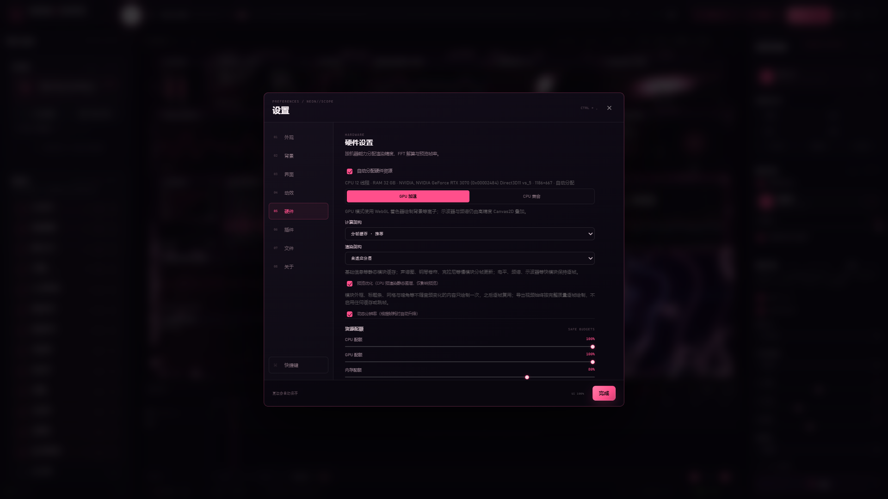

# NEON//SCOPE `CANARY`

**前沿测试频道 · 功能最先落地 · 不保证稳定**

[](https://github.com/Tatsukini/Tatsukini-NEON-SCOPE-Audio-Visualization-Canary/releases/tag/V0.1.4_Alpha_Canary_1115_1)
[](LICENSE)
[](https://github.com/Tatsukini/Tatsukini-NEON-SCOPE-Audio-Visualization)

> [!WARNING]
> **这是 Canary 测试频道，不是稳定版。**
> 本仓库的每个构建都直接对应一轮开发对话的改动，可能包含未完成的功能、行为变更、UI 重排与键位调整；存档与设置结构也可能随构建变化而不再兼容。跨构建恢复失败属于预期内的测试风险。
> 需要稳定出片，请使用 [稳定版频道](https://github.com/Tatsukini/Tatsukini-NEON-SCOPE-Audio-Visualization/releases)。

Canary 与稳定版共享同一套前端资源与桌面外壳，代码同源；差别只在发布节奏与验收强度。本仓库的 Release 说明均由该轮开发对话的实际改动汇总而成，涉及界面的版本会附上对应的测试截图。

---

## 频道对照

| | **Canary（本仓库）** | **Stable** |
| --- | --- | --- |
| 定位 | 前沿功能试验场，供测试与尝鲜 | 面向日常使用与出片 |
| 更新节奏 | 每轮改动单独构建、单独发版 | 功能沉淀并回归后发布 |
| 稳定性 | 可能引入行为变更、UI 重排、键位调整 | 冻结键位与工作流 |
| 存档兼容 | 每个构建都可能调整存档 / 设置结构 | 尽量保持兼容 |
| 问题反馈 | 本仓库 Issues，请注明构建号 | 稳定版仓库 Issues |
| 许可 | **AGPL-3.0-or-later**（比稳定版 GPL 更严格） | GPL-3.0-or-later |

---

## 界面测试图

以下截图全部取自当前构建 `V0.1.4_Alpha_Canary_1115_1`，1920×1080，示例工程 `WHEN RAIN`。

| 工作台 · 编辑与吸附 | 专注预览 · 无侧栏 |
| --- | --- |
|  |  |

| 设置 · 硬件（FFT 与资源配额） | 插件管理器 |
| --- | --- |
|  |  |

| 视频导出 | CATBOT PAPER 主题 |
| --- | --- |
|  |  |

---

## 本构建

| 项目 | 值 |
| --- | --- |
| 构建号 | `V0.1.4_Alpha_Canary_1115_1` |
| 通道 | Canary / Alpha |
| 基于 | `V0.1.4_Alpha_Canary_1114_12` |
| 构建日期 | 2026-11-15 |
| 许可 | AGPL-3.0-or-later（见 [LICENSE](LICENSE)、[NOTICE](NOTICE)） |
| 可执行文件 | `dist\NEON-SCOPE.exe`、`NEON-SCOPE-win64.zip` |

### 本轮改动

- **MP4 导出静默回退 WebM**：FFmpeg 转码需要把上传的录制文件与成片同时写进临时目录，临时盘写满时转码失败，界面只提示「转码失败」便回退 WebM。
  - 录制前先估算临时空间需求（约成片体积的 2 倍 + 512 MB），不足时直接报错并给出所需与可用空间，不再录完整段才失败。
  - 导出面板打开时刷新临时盘余量，低于估算需求时在摘要下方提示。
  - 转码失败回退 WebM 时，提示中显示真实原因（如临时磁盘空间不足、未检测到 FFmpeg 或服务端原始错误）。
- **MIDI O/C 轨道过多时漏显示 / 出界**：模块宽度达到 760 px 后自动分成左右两栏，两栏面积相同，窄模块仍保持单栏。
- **显示容量按模块高度计算**：行数与行高不再受设置值限制，纵向空间足够时会自动铺满并把所有轨道显示出来，只有高度真正装不下时才收起多余轨道。
- **溢出提示**：无法完整显示时，最后一格显示 `+ N More Track`，N 为未显示的轨道数。
- **空闲轨道不再留白**：当前没有音符活动的轨道显示为暗色行名，避免出现空白行被误认为漏显示。
- **去掉占位后缀**：合并 MIDI 轨道名后面的 `· Track 1` 不再显示，真实轨道 / 文件名保持不变。
- 移除「每栏最大轨道行数」设置，行数与行高完全由模块高度自适应。

### 测试重点

1. **高模块铺满**：把 MIDI O/C 拉高到能容纳全部轨道，确认所有轨道（含暂时空闲的暗色行）都显示出来，不出现 `+ N More Track`。
2. **宽屏分栏**：把 MIDI O/C 模块拉宽到 760 px 以上，确认轨道分成左右两栏、两栏宽度一致。
3. **溢出提示**：把模块压矮到装不下全部轨道，确认最后一格为 `+ N More Track`，N 与实际隐藏数量一致，且没有文字画出模块边界。
4. **占位后缀**：确认轨道行不再出现 `TRACK 1` 之类的占位文字，带真实名称的轨道仍显示原名。
5. **磁盘预检**：把导出临时盘剩余空间压到低于估算需求，确认开始录制前就提示「磁盘空间不足」并给出所需 / 可用空间，而不是录完整段后再回退 WebM。

### 回归清单

- [ ] 首次启动 → 确认 Alpha 提示 → 载入示例工程
- [ ] MIDI O/C 宽度 < 760 px 时保持单栏，行为与 1114_12 一致
- [ ] MIDI O/C 拉宽后分两栏，窄回后恢复单栏
- [ ] 高模块能显示全部轨道，不提前出现 `+ N More Track`
- [ ] 导出 MP4：临时盘空间充足时正常得到 MP4；不足时在录制前明确报错，不静默回退
- [ ] 轨道数不足时最后一行为真实轨道，不出现 `+ N More Track`
- [ ] 矮模块下所有行保持在模块内，溢出时显示 `+ N More Track`
- [ ] 暂停时导入 / 更换 / 清除封面，确认基础信息模块同步刷新
- [ ] 暂停时修改基础信息文本字段，确认模块文字立即变化
- [ ] 播放 10 分钟以上，确认舞台保持锐利、所有模块始终可见
- [ ] 修改模块位置 / 尺寸 / 标题 / 颜色，确认预览即时更新
- [ ] 隐藏 / 独显模块后再「显示全部」，确认布局与内容一致
- [ ] 导出 10 秒视频，检查慢模块逐帧变化、水印与片头片尾
- [ ] 以 125% / 150% / 200% 系统缩放打开设置，确认侧边栏始终纵向
- [ ] 设置面板走一遍，重启后核对设置与主色

---

## 快速开始（EXE）

**双击 `dist\NEON-SCOPE.exe`**。无需安装 Node.js 或 .NET 运行时。

- 运行环境：Windows 10 / 11 x64 + **Microsoft Edge WebView2 Runtime**；视频导出可选安装 **FFmpeg**（硬件编码、手动码率 / CRF 等进阶选项需要，详见下方「运行环境与硬件下限」）。
- 未签名构建，首次运行可能出现 SmartScreen 提示：更多信息 → 仍要运行。
- 数据目录优先 `%LOCALAPPDATA%\NEONScope\`，不可写时回退到 EXE 同目录的 `NEONScopeData\`；日志为其中的 `neon-scope.log`。
- 设置、布局与主色自动保存；工程状态默认不跨启动恢复，可在 设置 → 文件 开启「自动存档恢复」。
- 导出视频默认保存到系统「下载」文件夹。

网页版（开发 / 调试）：

```bash
node server.mjs
```

需要 Node.js 18+；加 `--no-open` 可避免自动拉起浏览器。EXE 与网页版共用同一套 `index.html / styles.css / js` 资源。

---

## 运行环境与硬件下限

当前构建仍是 **WinForms 外壳 + WebView2（Chromium）**：界面、音频分析与 Canvas 2D 渲染全部运行在 WebView2 内，EXE 已自带 .NET 运行时，不需要额外安装 Node.js 或 .NET。

| 项目 | 要求 |
| --- | --- |
| 平台 | Windows 10 1803（17134）及以上 / Windows 11，仅 x64；深色标题栏在 1809 及以上生效；暂无 ARM64 原生构建 |
| 运行时 | Microsoft Edge WebView2 Runtime（Windows 11 通常预装；Windows 10 随 Edge 更新安装，缺失时程序会给出下载地址） |
| 视频导出 | 可选。建议安装 FFmpeg 并加入 PATH，或把 `ffmpeg.exe` 放在 EXE 同目录 / `resources\` 下；硬件编码、手动码率 / CRF / 预设、降速录制恢复原速与 MKV / MOV 封装都需要它。未安装时，默认设置下使用 WebView2 原生直录（运行时支持 MP4/H.264 时输出 MP4，否则回退 WebM）；选择上述进阶选项时会回退到 WebM 直录 |
| 内存 | 8 GB 起；4K 导出建议 16 GB |
| 显卡 | 支持 DirectX 11 的 GPU，并启用硬件加速；无独显时依赖核显 |
| 磁盘 | 程序与示例资源约 100 MB；默认 24 Mbps 导出约 180 MB/分钟，40 Mbps 约 300 MB/分钟 |
| 显示 | 1366×768 起可编辑；1920×1080 及以上推荐 |
| 音频 | 任意可用的 Windows 输出设备；导出音频直接取自 WebAudio，无需声卡回录或虚拟声卡 |

### 硬件下限

推算依据（当前应用结构）：WebView2 / Chromium 多进程 + Canvas 2D 直绘；预览画布按 CSS 宽度 × DPR（上限 1.5）计算后截断到最大 1920×1080，导出可到 3840×2160；默认 FFT 8192、双声道分析；示例工程 19 个模块，单帧逐模块绘制并叠加辉光与扫描线；导出为实时录制，安装 FFmpeg 时再转码 / 封装。

| 平台 | 最低配置 | 推荐配置 |
| --- | --- | --- |
| Intel | 第 8 代 Core i3-8100 / i5-8250U（4 核起）+ UHD 620 / 630 核显 + 8 GB 内存 | 第 12 代 Core i5-12400 及以上 + UHD 730 / 770 或 Arc A380 / RTX 3050 + 16 GB 内存 |
| AMD | Ryzen 3 1200 + RX 550，或 Ryzen 3 2200G（Vega 8 核显），4 核起 + 8 GB 内存 | Ryzen 5 5600 及以上 + RX 6600 或更强 + 16 GB 内存 |

- **最低配置**：1080p 预览约 30 FPS，适合 1080p30 导出；模块较多时把 `设置 → 硬件 → FFT` 降到 4096 / 2048，或隐藏部分模块。
- **推荐配置**：1080p60 预览流畅，可进行 4K60 录制。
- **低于下限**（双核酷睿、FX 系列、仅支持 DX10 的显卡）：预览会明显掉帧，导出可能降速，不保证可用。

---

## 快捷键（常用）

按 `F1` 打开可搜索、可重绑定的完整快捷键映射；完整列表见 [稳定版 README](https://github.com/Tatsukini/Tatsukini-NEON-SCOPE-Audio-Visualization#快捷键)。

| 键 | 操作 |
| --- | --- |
| `Space` | 播放 / 暂停 |
| `←` / `→` | 快退 / 快进 1 秒（长按每秒 5 步） |
| `↑` / `↓` · `Shift + ← / →` | 微调所选模块 1 px · 10 px |
| `Delete` | 删除所选动画动作或模块 |
| `E` / `F` | 编辑模式 / 专注预览 |
| `G` / `L` | 吸附对齐 / 循环播放 |
| `Ctrl + S` / `Ctrl + Z` | 保存工程 / 撤销动画编辑 |
| `Ctrl + Shift + E` | 打开视频导出 |

---

## 与稳定版的差异

Canary 具备稳定版的全部工作台能力，并先行接收新功能；完整功能清单、插件规范与架构说明以[稳定版 README](https://github.com/Tatsukini/Tatsukini-NEON-SCOPE-Audio-Visualization)为准。当前基于 `V0.1.4` 线先行落地：

- **预览原生分辨率直绘**：按画布原生分辨率直接绘制（最大 1920×1080），不由 CSS 放大；预览与导出共用同一套绘制路径。
- **界面音效**：开关、按钮与关键操作使用合成音效，无外部音频文件。
- **退出自动存档握手**：退出前等待存档写完，失败时显示状态覆盖层。
- **方向键 / Delete 语义**：方向键微调模块，Delete 无需先聚焦面板即可删除。
- **设置侧边栏纵向布局**：窄窗口收为图标栏，不再退化成横向按钮条。

---

## 已知限制

- 实时录制导出，不支持后台静默渲染；导出期间保持窗口在前台。
- 4K / 60FPS 对性能要求高；硬件不稳时会自动降速录制。安装 FFmpeg 时由其恢复原速并封装；未安装时只能按原速直录，帧率不足会出现掉帧。
- MIDI 仅驱动可视化，不参与音频合成或分析。
- Canary 构建间的存档、设置与键位可能变化；跨构建异常请先清空应用数据目录再复测。
- 未签名构建在签名启用前仍可能触发 SmartScreen 提示。

---

## 许可 / License

**本仓库自 `V0.1.4_Alpha_Canary_1114_7` 起使用 GNU Affero General Public License v3.0 或更高版本（AGPL-3.0-or-later）**，比稳定版仓库的 GPL-3.0-or-later 更严格：

- 分发修改后的程序时，必须按 AGPL 提供完整对应源代码。
- 如果你修改程序并通过网络让其他用户使用，必须向这些用户提供修改版的对应源代码（AGPL 第 13 条）。
- 不得对 Canary 构建附加额外限制条款；如需更宽松的条款，请使用稳定版仓库的 GPL 构建。

`assets/` 下的示例音频、MIDI、字体与图片仍归各自作者所有，不在 AGPL 范围内；详见 [NOTICE](NOTICE)。应用内 设置 → 关于 → 许可与版权声明 同步列出本程序的 AGPL 条目。

---

## 开发者

```powershell
powershell -ExecutionPolicy Bypass -File .\build-native.ps1
```

要求 .NET 8 SDK；脚本在 `dist\` 生成 `NEON-SCOPE.exe` 并打包 `NEON-SCOPE-win64.zip`。

```
index.html / styles.css    工作台界面
js/                        前端模块、音频分析、MIDI、导出、音效
server.mjs                 网页版本地服务
native/                    C# 桌面外壳（WinForms + WebView2 + Kestrel）
build-native.ps1           重建 EXE
dist/                      可分发 EXE
```

GitHub Actions（`.github/workflows/build-windows.yml`）在推送 `V*` 标签或手动触发时构建未签名产物；当前仍未启用代码签名，EXE 首次运行可能触发 SmartScreen。

反馈请使用本仓库 Issues，并注明构建号与复现步骤。
